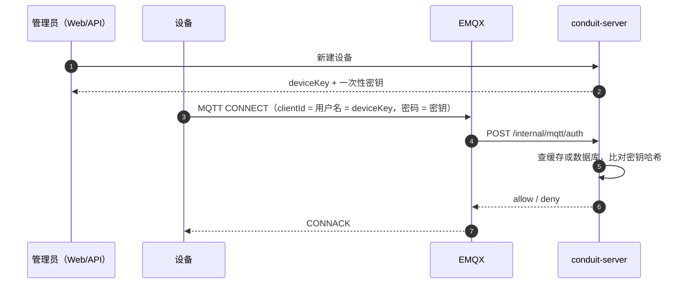

# 设备接入指南

本文说明一台设备从开通、连接到可靠数据上报的完整流程，以及对接时需要遵守的约定。内容对应 V0.2-R2 的实际实现。

管理 API 已增加项目/站点授权：创建或移动设备时，操作者必须具备目标站点内的 device.manage；建议显式传 `siteCode`（可选 `assetCode`）。未传站点时只在操作者有默认站点权限的兼容路径下成功。设备最新值、历史和密钥重置均先在 PostgreSQL 校验设备范围，无权返回404；MQTT 鉴权和设备上报仍按可信设备身份处理，不使用登录用户的数据范围，详见[授权说明](authorization.md)。

## 1. 整体流程

设备接入分两段：先开通和鉴权，之后才能上报数据。



连接成功后，每条数据按下面的链路流转。EMQX 的 PUBACK 只确认 broker 收到消息；设备必须保留本地副本，直到收到平台业务回执。该回执在 transport 成功写入 Redis Stream 后发出，表示“平台已持久接收”，不表示测点已经通过校验或写入 InfluxDB。


设备上下线不需要设备自己上报：EMQX 的连接、断开事件经 transport 进入同一条总线，由 server 更新在线状态。

## 2. 准备：产品和设备

设备必须挂在某个产品下。可以在 Web 界面操作（「产品」页新建产品，「设备」页新建设备），也可以直接调用 REST 接口：

```bash
API=http://<docker-host>:8090   # 经 nginx 代理；也可直连 API_PORT（默认 8091）

TOKEN=$(curl -s -X POST "$API/api/v1/auth/login" -H 'Content-Type: application/json' \
  -d '{"username":"<管理员用户名>","password":"<管理员密码>"}' | jq -r .accessToken)

# 新建产品，记下返回的 productKey（可选 "codec":"flat-json"，缺省为 standard-json）
curl -s -X POST "$API/api/v1/products" -H "Authorization: Bearer $TOKEN" \
  -H 'Content-Type: application/json' -d '{"name":"三相电表"}'

# 新建设备，记下返回的 device.deviceKey 和 deviceSecret
curl -s -X POST "$API/api/v1/devices" -H "Authorization: Bearer $TOKEN" \
  -H 'Content-Type: application/json' -d '{"productKey":"<productKey>","name":"1 号表"}'
```

> deviceSecret 只在新建或重置密钥时返回一次，平台只保存它的哈希。丢失后只能在「设备」页点「重置密钥」，重置后旧密钥立即失效。

## 3. 连接参数

| 参数 | 取值 |
|---|---|
| 地址 | Docker 宿主机地址 |
| 端口 | `MQTT_PORT`，默认 1883（未启用 TLS） |
| 协议 | MQTT 3.1.1 或 5 |
| clientId | deviceKey |
| 用户名 | deviceKey（必须与 clientId 相同） |
| 密码 | deviceSecret |
| 建议 keepalive | 60 秒 |

设备详情页的「连接参数」卡片会显示同样的内容，可以直接照抄。

**权限**：设备只能向自己的上行 topic `conduit/+/{deviceKey}/up/#` 发布，只能订阅自己的下行 topic `conduit/+/{deviceKey}/down/#`。往别的设备 topic 发会被 EMQX 拒绝。

## 4. 上报格式

**Topic**：`conduit/{productKey}/{deviceKey}/up/property`，QoS 使用 1。

**Payload**（UTF-8 JSON）：

```json
{
  "id": "dev01-000123",
  "ts": 1760400000000,
  "params": { "Ua": 220.1, "Ia": 5.2, "EPimp": 12345.6, "mode": "auto", "alarm": false }
}
```

| 字段 | 规则 |
|---|---|
| `id` | 可选字符串，1～128 个字符；同一设备内唯一。带上即启用可靠上报，建议使用“设备标识 + 单调序号” |
| `ts` | 采样时间，**毫秒**时间戳。可靠上报时必填，且重发必须保持不变；普通上报可省略。必须在 `[当前时间 − 30 天, 当前时间 + 5 分钟]` 之内 |
| `params` | 非空对象，值只能是数字、字符串、布尔，不能是 null、数组或嵌套对象 |
| 测点名 | 不能为空，不能以 `__` 开头（平台保留） |
| 数字 | 产品没有物模型时一律按浮点数存储（`220` 与 `220.0` 等价）；有物模型时按属性类型存储，见第 5 节 |
| 类型一致 | 同一测点一旦以数字写入，之后就不能再报字符串，反之亦然 |

同一设备、同一 `ts` 重复上报会覆盖为同样的值，因此设备重发是安全的。补传的旧数据会写入历史，但不会覆盖页面上的最新值。

### 4.1 扁平 JSON

产品的解码器选「扁平 JSON」（`flat-json`）时，测点直接放在顶层：

```json
{ "id": "可选", "ts": 1760400000000, "Ua": 220.1, "Ia": 5.2 }
```

顶层 `ts` 和 `id` 的规则与标准 JSON 相同，其余键都是测点，至少要有一个。解码器在「产品详情 → 基本信息」中选择，修改后立即生效。

### 4.2 平台业务回执

可靠上报设备连接后应订阅 `conduit/{productKey}/{deviceKey}/down/ack`。平台对每条带有效 `id` 的属性上报发送一条 QoS 0 回执：

```json
{ "id": "dev01-000123", "ts": 1760400000123 }
```

其中 `ts` 是平台接收上行的时间。设备按 `id` 删除本地待确认副本；超时未收到时，必须使用完全相同的 `id`、`ts` 和测点值重发。QoS 0 回执可能丢失，这是正常情况，重发会由同设备同时间戳的存储幂等性吸收。

设备侧待确认队列必须持久化到本地存储，并设置容量上限；队列满时应暂停采集新上报，不能删除最旧消息。仓库模拟器实现了同样的状态机，但演示用途的队列只保存在内存中。

## 5. 物模型

在「产品详情 → 物模型」中为产品定义属性（测点），也可以导入/导出 JSON（格式见 `docs/examples/demo-meter.thing-model.json`）。每个产品最多 200 个属性。

| 类型 | 接受的值 | 存储 |
|---|---|---|
| 浮点数 `DOUBLE` | 有限数值 | float |
| 整数 `INT` | 整数（`220.0` 也算），在 long 范围内 | integer |
| 布尔 `BOOL` | `true` / `false` | boolean |
| 文本 `TEXT` | 字符串，最长 1024 | string |
| 枚举 `ENUM` | 已定义的整数枚举值 | integer |

- 产品**没有**任何属性时，按 V0.1 规则接收（数值一律浮点）。
- 有物模型时逐测点校验：合格的测点照常入库；不合格的测点被剔除，并写一条 `FIELD_REJECTED` 死信记录，字段 `rejected` 列出每个被剔除的测点、原值（最多 64 个字符）和原因：`UNDEFINED`（未定义）、`TYPE_MISMATCH`（类型不符）、`OUT_OF_RANGE`（超出范围）、`TOO_LONG`（文本超长）、`ENUM_VALUE`（不是定义的枚举值）。全部测点都被剔除时整条消息进死信。
- 数据类型定义后不可修改；已经以浮点数写入过的测点请保持「浮点数」，定义为整数/枚举会与历史数据类型冲突（`FIELD_TYPE_CONFLICT`）。所有产品共用同一张时序表，同名测点在不同产品中也应使用相同类型。
- 修改物模型立即生效（多实例部署时最多延迟 60 秒）。

## 6. 对接示例

**命令行（mosquitto_pub）**

```bash
mosquitto_pub -h <docker-host> -p 1883 -q 1 \
  -i <deviceKey> -u <deviceKey> -P <deviceSecret> \
  -t conduit/<productKey>/<deviceKey>/up/property \
  -m "{\"ts\":$(date +%s%3N),\"params\":{\"Ua\":220.1,\"Ia\":5.2}}"
```

**Python（paho-mqtt 2.x）**

```python
import json, time
import paho.mqtt.client as mqtt

HOST, PORT = "<docker-host>", 1883
PRODUCT_KEY, DEVICE_KEY, SECRET = "<productKey>", "<deviceKey>", "<deviceSecret>"
TOPIC = f"conduit/{PRODUCT_KEY}/{DEVICE_KEY}/up/property"

client = mqtt.Client(mqtt.CallbackAPIVersion.VERSION2, client_id=DEVICE_KEY)
client.username_pw_set(DEVICE_KEY, SECRET)
client.connect(HOST, PORT, keepalive=60)
client.loop_start()

pending = load_pending_from_local_storage()

def on_message(client, userdata, message):
    ack_id = json.loads(message.payload)["id"]
    if ack_id in pending:
        del pending[ack_id]
        persist_pending(pending)

client.on_message = on_message
client.subscribe(f"conduit/{PRODUCT_KEY}/{DEVICE_KEY}/down/ack", qos=0)

while True:
    message_id = next_monotonic_id()
    payload = {"id": message_id, "ts": int(time.time() * 1000),
               "params": {"Ua": 220.1, "Ia": 5.2}}
    pending[message_id] = payload
    persist_pending(pending)         # 先持久保存，再发送
    client.publish(TOPIC, json.dumps(payload), qos=1)
    resend_expired_pending_unchanged()
    time.sleep(10)
```

仓库里的设备模拟器 `conduit-simulator` 是 Java 参考实现，使用 HiveMQ MQTT Client，支持业务回执、断线重连、超时重发与待确认队列背压。其待确认队列仅在内存中，不能直接照搬为生产设备的持久化方案。

## 7. 核对结果

- **Web**：「设备」页能看到设备「在线」，「最后上报」时间在更新；进入设备详情，最新值表格每 5 秒刷新一次。
- **API**：`GET /api/v1/devices/{deviceKey}/latest` 返回 `{deviceKey, values}`，`values` 每项为一个测点：`identifier`（测点标识）、`name`（物模型中的名称）、`value`、`ts`（采样时间）、`unit`、`decimals`、`enumLabel`（枚举值对应的名称）；测点在物模型中未定义时 `name`、`unit`、`decimals`、`enumLabel` 为 null。V0.1 中测点标识放在 `name` 字段，V0.2-A 起改为 `identifier`。

## 8. 常见问题

**连接被拒绝（CONNACK 返回未授权）**

- clientId 和用户名不一致，或者都不是 deviceKey。
- 密钥错误，或者已经重置过。
- 设备在平台上被禁用。
- 平台侧配置问题：`CONDUIT_INTERNAL_TOKEN` 在 EMQX 和 server 之间不一致。

**能连上，但页面上看不到数据**

消息到达平台后如果校验不通过，会进入死信队列，不会重试。可以这样查看最近几条死信及原因：

```bash
# 在宿主机的 deploy/dev（或 deploy/standalone）目录中执行
docker compose exec redis \
  redis-cli XREVRANGE conduit:stream:dead + - COUNT 5
```

| 死信原因 | 常见原因 |
|---|---|
| `MALFORMED_JSON` | payload 不是合法 JSON 对象，或有重复键 |
| `INVALID_PARAMS` | `params` 为空（扁平 JSON 为没有测点）、值类型不支持、测点名非法、数值溢出（无物模型时） |
| `TS_OUT_OF_RANGE` | 用了秒级时间戳、`ts` 不是整数，或设备时钟偏差过大 |
| `PRODUCT_MISMATCH` | topic 里的 productKey 和设备所属产品不一致 |
| `UNKNOWN_DEVICE` / `DEVICE_DISABLED` | 设备已删除或已禁用（禁用不会断开已有连接） |
| `FIELD_TYPE_CONFLICT` | 同一测点前后报了不同类型 |
| `FIELD_REJECTED` | 测点不符合物模型（部分剔除时原消息的合格测点已入库，见记录中的 `rejected`） |
| `UNKNOWN_CODEC` | 产品配置的解码器不存在（例如部署回退后），整条消息未处理 |
| `UNSUPPORTED_TYPE` | 发到了 `up/event`，暂不支持事件 |
| `MALFORMED_ENVELOPE` | 总线上的消息缺少必要字段（平台内部问题，与设备 payload 无关） |
| `PROCESSING_ERROR` | 平台内部处理异常，只影响这一条消息 |
| `MAX_DELIVERY_EXCEEDED` | 同一条消息投递超过 5 次仍未处理成功 |

**收到 PUBACK，但没有收到平台业务回执**

PUBACK 不能证明消息已持久进入平台。设备继续保留本地副本，并在自己的回执超时后原样重发。Redis 或 transport 暂时不可用时也采用同一处理；收到业务回执后才可删除副本。

## 9. 当前限制

- 只支持属性上报（`up/property`）；事件上报、下行命令、设备影子在后续版本提供。
- 未启用 TLS，凭证在网络中明文传输，只适合内网和演示环境。
- 禁用设备不会立即断开它已有的 MQTT 连接，之后上报的数据会进入死信。
- 只支持 MQTT 直连；HTTP、Modbus TCP 等协议计划在 V1.1 提供。
